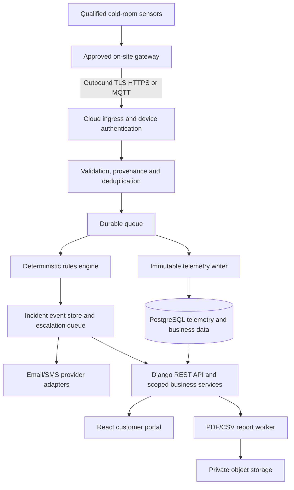

# SAMSEL Industrial Intelligence (SII)
## Codex Master Implementation Specification and Step-by-Step Build Plan

**Document version:** 1.0  
**Prepared for:** SAMSEL Group ApS, Denmark | CVR 46840070  
**Date:** 20 October 2026  
**Product type:** Fully proprietary, multi-tenant B2B industrial monitoring SaaS  
**Initial customers:** Food-processing companies, refrigerated/frozen storage facilities and their quality/operations teams  
**Primary market/languages:** Denmark; Danish and English  
**Implementation status:** NOT IMPLEMENTED. This file is the source-of-truth build instruction; do not claim any feature exists before code and tests prove it.

> **Instructions to Codex:** Treat this entire document as the product specification and execution backlog. Implement the software **incrementally, in the prescribed order, one sprint at a time**. Build genuine running code, migrations, tests, API contracts, UI and documentation. Do not stop at scaffolds, wireframes or descriptions. Do not attempt all sprints in one oversized change. For a fresh repository, **start Sprint 01 only**, then summarize, run all available checks and stop for the user's instruction to continue. For an existing repository, inspect it first, preserve working code and reconcile against this specification; then start the earliest incomplete sprint. Never connect to or modify real industrial equipment without separate explicit human approval and qualified site personnel.

---

# 0. Codex operating contract (READ FIRST)

## 0.1 Required first action

1. Inspect the current repository, including README, settings, package manifests, CI configuration, app structure, migrations and tests. If the repository is empty, create the agreed monorepo.
2. Report in `docs/IMPLEMENTATION_STATUS.md` what exists, what is missing, risks, assumptions and the **earliest incomplete sprint**. Do not silently discard existing implementations.
3. Create `docs/DECISIONS.md` (architecture decision log), `docs/REQUIREMENTS_TRACEABILITY.md`, `docs/SECURITY_REGISTER.md`, and `docs/CHANGELOG.md` if absent.
4. Before coding, show a compact sprint plan: relevant requirement IDs, affected services and files, models and migrations, API changes, UI/screens, tests and explicit out-of-scope items.
5. Implement **only the selected sprint**. Tests and developer tooling needed to complete that sprint are allowed; broad unrelated features are not.
6. At the end, run tests/lints/builds, fix actual failures, show command outcomes, list file changes, provide a manual verification checklist and update statuses. If a check could not run, mark it **NOT RUN** with reason; never mark it passed.
7. Stop and give the user the exact next command/prompt to begin the next sprint. Do not autonomously advance to another sprint.

## 0.2 Definition of Done for every sprint

- [ ] Functional implementation exists, not mock-only or TODO endpoints (except explicitly permitted test fakes).
- [ ] API and database contracts are implemented where applicable; schema migrations included and reversible when practical.
- [ ] Strict tenant and site authorisation is applied and verified for every new data path.
- [ ] Request validation, pagination, errors, rate limits and audit hooks are added as applicable.
- [ ] Backend unit/integration tests added and run; frontend component/E2E tests added where applicable.
- [ ] Device/industrial test data is simulated unless approved real-device access exists.
- [ ] No hard-coded credentials, production tokens, universally presumed food-safe temperature limits, or control commands.
- [ ] English and Danish labels included for introduced user-facing screens (if UI exists).
- [ ] OpenAPI schemas/types and sample data updated when contracts change.
- [ ] Docs, operational notes, security considerations and `docs/IMPLEMENTATION_STATUS.md` updated.
- [ ] CI builds or a documented local equivalent run. Failures are surfaced, not hidden.
- [ ] A concrete end-to-end demonstration path is provided.

## 0.3 Never do these

- Never claim this platform certifies food safety, guarantees prevention of food spoilage, or replaces customers' HACCP/own-check responsibilities.
- Never prescribe default legal/critical food storage temperatures to customers. **Any temperature limits in tests/demo must be visibly fictional** and must not activate customer monitoring until reviewed by their QA/HACCP manager.
- Never issue write/control commands to compressors, refrigeration systems, PLCs, Modbus registers, actuators or building management systems.
- Never interpret a sensor/data outage as a healthy reading; unknown, offline and stale are distinct high-visibility states.
- Never overwrite/delete raw telemetry or approved audit history during routine operations; append corrections/annotations and follow retention/legal-hold rules.
- Never make tenant isolation an optional frontend filter; enforce it in backend queries, workers, exports and device ingestion.
- Never infer that an email/SMS provider HTTP success means a human received or acknowledged an alarm.
- Never automatically close safety incidents from late backfilled data or a momentary recovered reading.
- Never claim regulatory compliance, security certification, hardware compatibility, achieved energy savings or SLAs without evidence.
- Never store payment card data or actual credentials in test fixtures, logs or repository.

## 0.4 External dependencies, permissions and uncertainty

Write working local adapters/fakes where credentials or suppliers are unavailable; isolate behind production-capable interfaces. Explicitly mark live integration as **BLOCKED: CUSTOMER/SUPPLIER APPROVAL REQUIRED** if applicable. User approval and professional sign-off are mandatory before: (a) accessing production OT networks/sensors, (b) turning on live customer alerting, (c) using customer personal or production data, (d) deploying to production, (e) using paid third-party services, or (f) representing the service as production-grade monitoring.

When something is underspecified, choose a secure, simple, reversible default, record it in `docs/DECISIONS.md`, and proceed with work that can be done safely. Ask for input only if proceeding would risk a destructive change, real equipment, legal sign-off, financial charge, unapproved external action or materially different product behavior.

## 0.5 Source hierarchy and reconciliation

This master specification merges the previously prepared SAMSEL Industrial Intelligence **Business Plan** and **Software Product Requirements Specification** dated 20 October 2026. When design details are ambiguous, prioritise: (1) safety/security boundaries in this document, (2) P0 functional acceptance criteria, (3) explicit architecture constraints, (4) P1/P2 roadmap, (5) financial/pricing assumptions. All costs/pricing are research hypotheses, **not** assertions of commercial validation. Do not use market estimates to justify software features without pilot feedback.

---

# 1. Product and business context

## 1.1 What to build

Build an original SAMSEL-owned cloud platform named **SAMSEL Industrial Intelligence** that receives read-only temperature telemetry from authorised industrial gateways/sensors, monitors food-industry cold rooms, displays data freshness and equipment health, detects temperature excursions and missing data, tracks alerts and human corrective actions, and creates auditable PDF/CSV reports.

The platform serves distinct customer organisations, each with one or more sites (factory/warehouse), buildings, cold rooms, zones, gateways, sensors, staff and customer-approved threshold policies.

**Initial value proposition:** "Know when your cold room needs attention. Alert the right people, keep trustworthy records, and document what happened."

**Immediate MVP outcomes:**
- Two supervised **paid pilot** customers after validation and qualification.
- Secure multi-tenant and site-scoped portal in Danish and English.
- Verified sensor ingestion with traceability and visible data-quality/freshness indicators.
- Deterministic, customer-approved threshold/no-data alerting and escalation attempts.
- Acknowledgement, corrective-action evidence, QA verification and immutable incident timeline.
- Auditable PDF/CSV exports suitable for supporting customer review processes.
- Deployable staging/pilot stack with backups, observability and tested recovery procedures.

## 1.2 Business assumptions (do not bake them into safety logic)

All pricing is **illustrative, in DKK excluding VAT**, subject to customer testing and contracts:

| Package | Indicative platform subscription / month | Indicative one-time setup | Draft scope |
|---|---:|---:|---|
| Paid pilot | DKK 8,000–15,000 total / 30–60 days | Scoped | One supervised site, limited hardware/integration |
| Essential | DKK 2,950 | DKK 15,000 | 1 site; up to 10 sensors; dashboards; email alerts; PDF export |
| Operations | DKK 5,900 | DKK 35,000 | 1 site; up to 40 sensors; escalation; reporting; scheduled customer reviews |
| Enterprise | From DKK 12,900 | From DKK 75,000 | Multi-site; agreed SLAs; API/SSO/custom workflows (P1/P2) |

Possible add-ons: more connected sensors, SMS/voice usage, longer retention, custom integrations, qualified calibration, partner installations. Build flexible **server-side** plan/quotas rather than hard-coding prices into front-end components. MVP only needs plan state, quotas, invoice export; real checkout/accounting integrations are P1 and require configuration.

Rough programme investment hypothesis from the business plan: DKK **1.19m–2.5m** for a funded professional build and go-to-market effort. Pilot-ready MVP: roughly **6–9 months**; commercial v1: **9–12 months** from a funded start. These are planning assumptions, not engineering time commitments or guarantees.

## 1.3 Primary customer profiles

1. **Food processor:** one to five production/storage sites, QA manager, several chilled/frozen rooms, manual logs or fragmented sensor tools.
2. **Cold-storage warehouse operator:** numerous rooms, after-hours incidents, sensor health and traceability requirements.
3. **Food distributor with storage facilities:** needs temperature history and efficient incident investigation.
4. **Integration/referral partner:** refrigeration technicians, accredited calibration providers, industrial electricians, food-safety consultants. These are not authorised to see customer data by default.

## 1.4 Business validation gates (outside code, but supported by product demos)

- Gate A: 15 prospective buyer interviews, three detailed site/data assessments and two signed paid pilot or conditional purchase commitments before releasing full build funding.
- Gate B: Demonstrate offline/replay handling, alarms, historical traceability, tenant isolation and credible installation cost before live pilots.
- Gate C: Obtain customer's signed limits, contact roster, commissioning record, operator contingency procedure, site acceptance and agreed support terms before activating live alarms.
- Gate D: Five paying production sites and acceptable real cost-to-serve before committing to cross-border expansion.

---

# 2. Scope and delivery priorities

## 2.1 MVP P0: mandatory before commercial monitoring launch

| Category | Feature | Requirement IDs |
|---|---|---|
| Foundation | Monorepo, API/UI, PostgreSQL, queues, CI/CD, Docker, reproducible environments | EP-01, NFR-12 |
| IAM | Invite-only accounts, verified email, reset, MFA for privileged users, session security | AUTH-01 |
| Tenancy | Organisations/sites, site-level RBAC, support elevation, tenant-safe audit | AUTH-02, AUTH-03, TEN-01, TEN-02, AUD-01 |
| Commercial admin | Plan state, site/sensor quotas, subscription status, basic invoice export | BILL-01 |
| Assets | Site/building/zone/sensor/gateway, commissioning, calibration, lifecycle | ASSET-01..05 |
| Telemetry | Authenticated HTTPS + secure MQTT, validation, dedup, buffering/replay, gap detection, CSV import | ING-01..07 |
| Rules | Versioned QA-approved thresholds, sustained breach, hysteresis, data-quality alarms | RULE-01..05 |
| Notifications | Email paths, escalation, attempts/retries, dry run, failure reporting | ALERT-01..06 |
| Incident workflow | Acknowledge, assign, record corrective action, QA close and immutable chronology | ALERT-03, AUD-01 |
| Visualisation | Cross-site dashboard, zone chart, offline/stale state, incident centre | DASH-01..03, UX-01 |
| Reports | PDF/CSV exports with gaps/calibration/site timezone; auth-gated access, audit | REPORT-01..02 |
| Operations | Security, backup/restore, logs, monitoring, load and outage exercises | NFR-01..12 |

Do not treat P0 as complete if it works only with hard-coded tenant IDs, unqualified real sensors, in-memory queue state, fake user tokens or a demo-only local dataset. A simulator is appropriate for development; the live pilot requires qualified gateway commissioning and human safety review.

## 2.2 P1: implement only after pilot validation

- Authorised electricity meter imports via Energinet/ElOverblik APIs; tariff rules, energy usage and conservative non-guaranteed savings analysis (`EN-01..03`).
- Verified read-only refrigeration runtime, door-open and defrost event integrations (`MAINT-01`).
- Tenant-authenticated external APIs, outbound webhooks, robust developer docs (`INT-01`).
- Danish e-invoicing/payment-provider integrations where justified (`COM-01`).
- Scheduled report email delivery, localisation improvements and additional operator experience enhancements.

## 2.3 P2: defer until demand and datasets justify

- Enterprise SSO/SAML/OIDC (`ENT-01`), Swedish/German/Dutch language packs (`LANG-01`), native apps (`MOBILE-01`).
- Machine-health/anomaly models (`PRED-01`) only on validated failure-labelled data; human-reviewed signals, confidence and false-positive tracking; no automated food disposition or equipment control.
- Cross-country regulatory/contract adaptations and enterprise analytics.

## 2.4 Explicitly excluded from initial build

PLC writes, changing refrigeration setpoints, control-system automation, certified HACCP workflows or third-party certification claims, automatic release/disposal of food, promises of guaranteed alerts/24h human response, pharmaceutical GxP monitoring, customer ERP, generative-AI-only incident decisions, unsupported sensor protocols and native mobile applications.

---

# 3. Architecture and firm technical decisions

## 3.1 Default technology stack

The system is proprietary application code **without a white-label IoT software core**. It may use well-supported OSS/managed infrastructure. Use compatible **currently supported stable versions pinned in lock files**; document exact selected versions and their support/licences in the first ADR instead of guessing unverified version numbers.

| Area | Implementation preference | Notes |
|---|---|---|
| Portal | React + TypeScript + Vite; React Router; accessible component library | Desktop-first, responsive mobile incident flows |
| State/data | TanStack Query, typed API client generated from OpenAPI | Server is source of truth; no tenant-local trust |
| Forms | React Hook Form + schema validation | Server validates again |
| Visuals | Accessible chart library with raw/aggregate distinction | No false "all safe" indicators |
| API | Python 3.12+; Django supported LTS; Django REST Framework | Modular monolith for business domains |
| API docs | OpenAPI 3.1-compatible schema tooling | Version prefix `/api/v1/` |
| Authentication | Django session cookies + CSRF for first-party SPA; Django MFA/TOTP flow | Separate gateway/device credentials; never use human tokens |
| Core DB | PostgreSQL | UUID PKs; explicit tenant-scoping; UTC timestamps |
| Telemetry DB | PostgreSQL partitioned tables initially | Time-series extension only if tested/licence appropriate |
| Queue | RabbitMQ | Durable messages, retry/DLQ, explicit ack semantics |
| Workers | Celery | Separate ingestion, rules, reports, notifications queues |
| Cache | Redis | Cache/rate limits, **not** only persistence layer |
| Object storage | S3-compatible EU-region private bucket; MinIO locally | Encrypted report artifacts and raw payload backups |
| HTTPS device ingress | Proprietary device ingestion module/service | Signed or mTLS device identity, replay protection |
| MQTT ingestion | MQTT broker as transport, proprietary authenticated consumer/validator | TLS in production; isolated per-device topics/ACLs |
| Observability | OpenTelemetry, logs, metrics, alerting | Avoid sensitive payloads in logs |
| Local infrastructure | Docker Compose | Fully self-contained with synthetic data |
| Deployment | Containers, managed Postgres, EU/EEA cloud, IaC | Secret manager, staging/prod isolation |
| CI | GitHub Actions or repository's existing CI | Lint, typecheck, tests, vuln scan, build |

**Authentication security ADR:** First-party web portal uses secure HTTP-only session cookie, CSRF and server-side session revocation. Device ingestion uses separate per-gateway credentials (prefer mTLS in high-assurance production; support rotated HMAC credentials via encrypted server-side secrets where justified). Avoid exposing privileged user tokens in browser localStorage. Production choices need formal threat assessment.

**Deployable shape:** Business modular monolith + a logically separate telemetry pipeline. Do not create many tiny microservices or multiple databases per business module before load testing proves a need. Queue workers and MQTT ingestion can scale independently.

## 3.2 Logical dataflow



**Network separation:** Plant connections initiate outbound only. No public access to Modbus/OPC UA/PLCs or plant OT. The gateway uses read-only capabilities; initial development uses a simulated gateway exclusively.

## 3.3 Required monorepo layout

Adopt the existing structure if sound, otherwise start with this template:

```text
samsel-industrial-intelligence/
  README.md
  AGENTS.md                          # Optional pointer to this master specification
  .env.example                      # Placeholder values ONLY
  .gitignore
  compose.yaml
  Makefile
  .github/workflows/ci.yml
  apps/
    api/
      pyproject.toml
      manage.py
      config/                      # Django settings, URLs, ASGI, Celery
      sii/
        accounts/
        tenants/
        assets/
        devices/
        telemetry/
        monitoring/
        incidents/
        notifications/
        reports/
        billing/
        audit/
        support/
        common/
      tests/
    web/
      package.json
      src/
        app/
        components/
        features/
        pages/
        i18n/
        api/
        styles/
      tests/
    ingest/                        # Add only when interface needs independent scaling
  packages/
    api-contracts/                 # OpenAPI-generated TypeScript types
    event-contracts/               # Schema definitions and versioning
  simulator/
    gateway/                       # Synthetic telemetry and offline/backfill scripts
  infra/
    docker/
    terraform/                     # Or chosen IaC, add in deployment sprint
    monitoring/
  docs/
    IMPLEMENTATION_STATUS.md
    DECISIONS.md
    REQUIREMENTS_TRACEABILITY.md
    SECURITY_REGISTER.md
    CHANGELOG.md
    API.md
    DEPLOYMENT.md
    INCIDENT_RESPONSE.md
    DATA_RETENTION.md
    COMMISSIONING.md
  tests/
    e2e/
    fixtures/
```

## 3.4 Environments and configuration

- `local`: fake SMTP, simulated telemetry, MinIO, RabbitMQ, Postgres, Redis, API, React. No external writes.
- `test`: isolated temporary database/queue; deterministic clock/event fixture support.
- `staging`: EU cloud, synthetic data unless customer explicitly approves otherwise; mirrors production controls.
- `pilot`: customer-scoped dedicated release gate, stronger monitoring, qualified device/site sign-off.
- `production`: only after security/legal/operational/manual approvals.

Require HTTPS, correct secure cookie settings, CSRF/CORS allowlist, secure headers, rate limiting, rotated secrets, managed backups and restricted network access in non-local environments. Provide health/readiness endpoints that do **not** disclose client data.

---
# 4. User roles, permissions and tenancy

## 4.1 Roles and permitted actions

| Role | Allowed | Never allowed by default |
|---|---|---|
| SAMSEL Super Admin | Provision organisations, manage commercial plan, view platform health, request scoped support | Browse customer's readings without explicit approval; impersonate invisibly |
| SAMSEL Support Analyst | Access approved tenant/site under expiring, purpose-logged session | Edit raw telemetry; approve customer's critical limits; use standing access |
| Organisation Owner | Manage organisation users/sites, billing, retention/export and support approval | Access other organisations |
| Site Admin | Manage assigned site's zones/devices, draft rules, assign users | Approve critical rules if not separately assigned QA role |
| QA/HACCP Manager | Approve versioned critical limits, verify/close incidents, approve report evidence | Destroy raw logs, certify legal compliance automatically |
| Operations Manager | View site, oversee incidents and assign operational work | Approve QA thresholds without QA scope |
| On-call Operator | View scoped incidents, acknowledge, comment, record corrective action | Edit critical rules or see unrelated sites |
| Read-only Auditor | View specifically granted sites/reports/audit evidence | Edit anything, see billing unless separately granted |
| Device/Gateway principal | Send authenticated data for assigned sensors | Use human APIs, send for other device/site, read user data |

**Authorization design:**
- A natural person may have multiple roles for one or more sites; permissions derive from active membership + role assignment + site scope, **not** requested `organisation_id`.
- Use UUID identifiers, but never mistake unguessable IDs for authorisation.
- Admin support must be approved by organisation owner, scoped to sites, time-limited, revocable, reason-coded, logged and visible to customer; emergency process must be documented separately and cannot silently bypass customer constraints.
- Privileged roles (all site administrators, QA approvers, SAMSEL admins) require MFA; threshold approval and high-risk role change additionally require recent step-up confirmation.
- Device principals are separate from users and cannot log into the human UI.

## 4.2 Cross-tenant threat tests (release blocking)

Create two organisations, A and B, each with sites, sensors, raw readings, incidents, rules, exports and users. For every API, query/job and export:

1. A-authenticated user cannot fetch B's data by guessing IDs, changing URL/query/body, following an export link or asking for aggregate statistics.
2. B-authenticated user cannot update A's record via nested object IDs.
3. A's device credential cannot submit B's sensor measurements or spoof organisation ID.
4. A's queued event cannot cause write into B's incident/audit/report tables.
5. A staff support session expires and loses access after revocation or time limit.
6. A generated report accessible to A cannot be downloaded through B's session, even with a leaked object key.
7. Search, CSV import, notifications, email subject/body and background job logs do not leak another organisation's site data.

Make a parametrised negative-test suite that stays in CI for the life of the product.

---

# 5. Domain model and migrations

Use Django migrations; add database foreign keys, uniqueness, indexes and `CheckConstraint`s. Every business entity that can contain customer data must have a direct immutable `organisation_id`; verify related objects are from the same tenant on **every write**, with tests. Some global objects (plan catalog, system policy) are not tenant-specific. All business timestamps use timezone-aware UTC, rendered using each site's IANA timezone.

## 5.1 Core domain entities

| Domain | Models / key fields | Rules |
|---|---|---|
| Identity | `User(id,email,verified_at,is_active,mfa_enabled,...)`, `Invitation(id,org_id,email,token_hash,expires_at,accepted_at)`, `Membership`, `RoleAssignment(id,org_id,site_id nullable,role)` | Case-normalised unique email; no plaintext invite tokens stored; expiry/replay protection |
| Organisation | `Organisation(id,name,country_code,timezone_default,contract_status)`, `Site(id,org_id,name,timezone,service_state)`, `Building(id,org_id,site_id,name)`, `Zone(id,org_id,site_id,building_id,zone_type,sop_reference,criticality)` | Explicit site scoping and timezone; no critical limits from zone category |
| Devices | `Gateway(id,org_id,site_id,external_id,state,last_heartbeat_at,firmware_version)`, `Sensor(id,org_id,site_id,zone_id,gateway_id,external_id,type,unit,expected_interval_sec,state,calibration_due_at)` | Device ownership immutable post-registration without auditable transfer protocol |
| Device security | `DeviceCredential(id,org_id,gateway_id,key_identifier,secret_ciphertext/cert_fingerprint,activated_at,expires_at,revoked_at)` | Store encryption-managed credential only if needed for signature verification; redact secrets from admin APIs and logs |
| Qualification | `CalibrationRecord(id,org_id,sensor_id,reference,checked_at,due_at,recorded_by)`, `SensorCommissioning(id,org_id,sensor_id,technician_id,test_results,approved_at)`, `SiteCommissioning(...)` | No active monitoring until approved QA limits, sensor checks and contact route tests |
| Telemetry | `TelemetryRaw(id,org_id,sensor_id,event_uuid,recorded_at_utc,received_at_utc,value_decimal,unit,payload_hash,raw_payload_ref,source,quality_flags,sequence)` | Append-only, deduplicated; preserve original payload/provenance, skew/late flags |
| Quarantine | `TelemetryRejected(id,org_id nullable,device_claim,received_at,reason_code,payload_hash,redacted_metadata)` | Never leak raw credentials; unknown tenant safely represented; no accepted reading from rejected data |
| Health | `GatewayHeartbeat(id,org_id,gateway_id,received_at,observed_at)`, `SensorState(id,org_id,sensor_id,last_valid_at,last_received_at,health_state)` | Distinguish no valid data from gateway absent; derive health from trusted events |
| Rules | `RuleSet(id,org_id,zone_id,...)`, `RuleVersion(id,org_id,ruleset_id,version,min_value,max_value,sustained_sec,hysteresis,recovery_sec,effective_at,state,approved_by,approved_at)` | Draft -> tested -> approved -> active -> superseded; immutable approved versions |
| Evaluation | `RuleEvaluation(id,org_id,rule_version_id,sensor_id,window_end_at,result,quality_summary,correlation_id)` | Reproducible, idempotent evaluation with evidence of source window |
| Incidents | `Incident(id,org_id,site_id,zone_id,sensor_id,rule_version_id nullable,kind,severity,status,opened_at,assigned_to,closed_at)`, `IncidentEvent(id,org_id,incident_id,event_type,actor_id,timestamp,metadata)` | Append-only event timeline; closures preserve history |
| Alert routing | `EscalationPolicy`, `AlertRoute`, `NotificationAttempt(id,org_id,incident_id,channel,recipient,attempt_at,provider_message_id,provider_status,failure_code)` | Track *attempted*, *accepted by provider*, *failed*; human acknowledgement separate |
| Response | `Acknowledgement(id,org_id,incident_id,user_id,acknowledged_at)`, `CorrectiveAction(id,org_id,incident_id,author_id,description,evidence_ref,recorded_at)`, `QAReview(id,org_id,incident_id,qa_user_id,outcome,reviewed_at)` | Acknowledge != close; source events immutable; QA approval on closure |
| Reporting | `ReportJob(id,org_id,site_ids,period_start,period_end,format,status,requested_by)`, `ExportArtifact(id,org_id,job_id,object_key,checksum,expires_at)` | Asynchronous, signed/short-lived download, audited access and output integrity |
| Commercial | `Plan(id,code,limits,features)`, `Subscription(id,org_id,plan_id,state,starts_at,ends_at,...)`, `InvoiceRecord(id,org_id,...)` | Quotas on backend, no actual charging without provider approval |
| Governance | `AuditEvent(id,org_id nullable,actor,action,subject,before_hash,after_hash,occurred_at,prev_hash,event_hash)`, `SupportSession`, `DataRetentionPolicy`, `DataDeletionJob`, `LegalHold` | Evidence integrity, purpose-logged support, retention/legal hold |
| P1 Energy | `EnergyMeter`, `EnergyReading`, `TariffSchedule`, `EnergyBaseline` | Separate energy and temperature ingestion/provenance; customer permission required |

**Important:** The above is the intended logical model, not an instruction to create all tables in Sprint 1. Implement each domain in its scheduled sprint with migration and tests.

## 5.2 Key invariants and indexes

- UUID primary key for externally referenced objects.
- `UNIQUE(organisation_id, sensor_id, event_uuid)` for accepted telemetry. Device replay handling should additionally respect gateway identity and sequence where configured.
- Index `(organisation_id, sensor_id, recorded_at_utc DESC)` for readings.
- Index `(organisation_id, site_id, status, opened_at DESC)` for incidents.
- Index `(organisation_id, occurred_at DESC)` for audit events; event chain append-only.
- Index `(organisation_id, sensor_id, last_valid_at)` or equivalent health-check selectivity.
- Enforce one effective approved rule version per overlapping zone/rule category/time period, unless design explicitly supports precedence; reject unresolvable conflicts.
- Use `Decimal` for numeric temperatures and amounts; record canonical measurement unit **and** original unit.
- Store raw sensor timestamp separately from server receipt timestamp; never invent missing observations through interpolation.
- Deletions of operational configurations are soft-delete/archive with stable historic references. Raw telemetry changes are captured as separate annotations/corrections, not mutations.
- Make rule engine and alert operations transactional, with idempotency keys and an outbox pattern if necessary to avoid losing incident events while publishing notification jobs.
- Restrict object storage keys to random opaque values; no publicly listing buckets or embedding personal data in object keys.

## 5.3 Retention proposal (requires customer/legal validation)

Draft **configurable**, NOT statutory, defaults: 12 months for high-resolution raw telemetry, 36 months derived aggregates, 36 months incidents and audit/evidence records. Do not silently delete original evidence for active incidents, customer legal holds or pending exports. Implement documented deletion jobs, failed deletion audit, backup expiry policy and export-before-deletion. A retention system may ship with conservative administrator-controlled policies initially, but never imply universal Danish legally mandated periods.

---

# 6. End-to-end workflows and state machines

## 6.1 Customer and site onboarding

`SALES_HANDOFF -> ORGANISATION_INVITED -> USERS_VERIFIED -> SITE_DEFINED -> DEVICE_PLANNED -> DEVICE_COMMISSIONING -> RULES_QA_APPROVED -> ROUTES_TESTED -> CUSTOMER_ACCEPTANCE -> ACTIVE`

- Invite-only customer organisation. The customer owner creates site, zone, staff assignments, on-call roster and sensor/gateway inventory.
- Gateway provisioning is secure, linked to exactly one organisation/site and only its assigned sensors.
- A qualified partner documents physical sensor installation, placement and calibration reference.
- QA manager reviews/approves site-specific monitoring thresholds and SOP reference; system does **not** recommend an arbitrary universal food threshold.
- Email/test notification and no-data drill are performed; record outcomes.
- Activation is blocked until customer has signed the site monitoring responsibility/contingency acceptance checklist. Admin override, if ever implemented, must be explicitly authorised, purpose-logged and not misrepresented as production readiness.

## 6.2 Valid temperature event ingestion

1. Gateway sends authenticated event containing `device_id`, `sensor_id`, `event_uuid`, `observed_at`, `value`, `unit`, `sequence`, optional firmware/device status.
2. Verify TLS; scoped, unrevoked device credential; assigned sensor; signature or mTLS identity; payload limits.
3. Validate schema, numeric unit, plausible engineering limits configured for **sensor capability**, timestamp skew, duplicate and replay conditions. Do not confuse engineering sensor range with customer food-safety limits.
4. Persist accepted event durably. Preserve raw payload hash/provenance and received timestamp; return acknowledgement **only after durable acceptance**.
5. Publish processing event with tenant-scoped, versioned event envelope. Invalid events enter quarantine/rejection log and **cannot** count as healthy observations.
6. Update freshness/quality projection and evaluate currently effective approved rules by trusted event order, preserving late arrivals.
7. Append event/incident transitions and schedule alert jobs where necessary; keep all operations idempotent under retries and worker crashes.

## 6.3 Rule breach and recovery

Suggested incident statuses: `open -> acknowledged -> investigating -> action_taken -> qa_review -> closed`, with restricted backward transitions; separate `reopened` event allowed by policy.

**Threshold breach:** Use customer-approved `lower_bound`, `upper_bound`, `sustained_seconds`, `hysteresis`, `recovery_seconds`, effective dates. Open incident only for sustained, adequately supported readings; assign type (`too_warm`, `too_cold`, `rapid_change`, `invalid_reading` as appropriate). Never generate multiple open incidents for the same rule/sensor/breach episode after retries.

**Recovery:** Record `recovered` observation after appropriate recovery window; do not automatically declare food safe or close incident. Closure requires role, rationale and QA approval according to severity and site policy.

**Missing data:** Independently schedule freshness checks. If no **valid** expected readings arrive after approved grace: mark sensor `stale/offline`, open `sensor_no_data` incident; separately detect `gateway_offline`. Backfill later never erases that gap or old notification history.

**Maintenance/suppression:** Controlled scope and expiry; approvals, audit, preserved readings, visible warning; no silent hiding of incidents, and customer contingency remains documented.

## 6.4 Alert delivery and human response

- P0: email notification through provider adapter, with local fake SMTP; P1 optional SMS/voice **only after tested cost and delivery behavior**.
- Determine recipients by site, shift/timezone, severity, role and escalation policy. Escalate according to policy if not acknowledged, including provider failure/unavailable route status.
- Persist every attempt, retry, provider response, duplicate/idempotency key and failure classification. Use exponential backoff with bounded retries and dead-letter review.
- **Provider accepted != delivered to device != read != acknowledged by person.** Never coalesce these states.
- If all notification routes fail, show explicit failure in the platform/service status and follow the customer's separately agreed contingency workflow; do not invent staff interventions.
- Test/dry-run sends clearly marked synthetic alarms and logs who initiated the test.

## 6.5 Incident and corrective action

- On-call operator can acknowledge and enter notes with actor/time.
- Operations manager can assign personnel.
- Corrective action records what was inspected, what was changed by humans and any evidence. No commands to industrial equipment originate from SII.
- QA reviewer verifies adequacy and closes only after required fields and site-defined SOP are satisfied.
- Every transition appends to an immutable chronology; edits are subsequent amendment events with before/after data, reason and actor.

## 6.6 Report creation and export

User selects site(s), zones, date/time interval and report category. Worker generates PDF/CSV with:

- Organisation/site/zone, clearly identified report timeframe and local timezone (and UTC offset/DST where relevant).
- Sensor identification, current calibration status and source/provenance notes.
- Observed valid readings plus documented inclusion/exclusion rules; sample coverage and data gaps.
- Effective customer-approved rule version(s), incidents, notification attempts, acknowledgements, corrective actions and QA reviews.
- Document version, generation timestamp, requester, checksum and explicit draft/approved status where configured.
- No guarantee that absence of an alarm proves the food was safe.

Securely store artifact in private object storage; authorise download through scoped API and short-lived link/token, and record all export accesses.

---

# 7. API and event contracts

## 7.1 Global API standards

- Public business API prefix `/api/v1/`; version breaking changes.
- OpenAPI schema generated by code and committed/validated in CI; TypeScript client/types generated for frontend.
- Use request IDs/trace IDs, ISO-8601 time strings with offsets, explicit site timezone, decimal string for precision-sensitive values.
- Standard errors: `code`, `message`, `details`, `request_id`; 400 validation, 401 unauthenticated, 403 forbidden, 404 scoped not-found, 409 duplicate/conflict, 422 semantically invalid, 429 throttled as appropriate.
- Pagination for collections; explicit per-site filters with tenant-scope; upper bounds on report windows, page sizes, batch uploads and sensor query resolution.
- Distinct endpoints/scopes for device ingestion and human API. Device credentials have **no permissions** on human APIs.
- For commands and bulk ingestion, use explicit idempotency keys; prevent retry duplications.

## 7.2 Endpoint inventory (incrementally implement in assigned sprint)

| Method | Endpoint | Caller / behavior |
|---|---|---|
| `POST` | `/api/v1/auth/invitations/accept/` | Accept single-use invitation and set credentials |
| `POST` | `/api/v1/auth/login/` | First-party session; enforce appropriate MFA |
| `POST` | `/api/v1/auth/logout/` | Revoke server session |
| `POST` | `/api/v1/auth/password-reset/request/` | Prevent account enumeration |
| `POST` | `/api/v1/auth/password-reset/confirm/` | Single-use reset |
| `POST` | `/api/v1/auth/mfa/enroll/` | Privileged verified user, secure TOTP enrolment |
| `POST` | `/api/v1/auth/mfa/verify/` | Complete MFA challenge |
| `GET` | `/api/v1/me/` | Identity + scoped memberships |
| `GET/POST` | `/api/v1/organisations/` | Admin-scoped; no public tenant listing |
| `GET/PATCH` | `/api/v1/organisations/{org_id}/` | Organisation owner and authorised support |
| `GET/POST` | `/api/v1/organisations/{org_id}/sites/` | Organisation/site-scoped user |
| `GET/POST` | `/api/v1/sites/{site_id}/buildings/` | Site admin |
| `GET/POST` | `/api/v1/sites/{site_id}/zones/` | Site admin |
| `GET/POST` | `/api/v1/sites/{site_id}/gateways/` | Site admin; credential provision response is one-time secret view |
| `GET/POST` | `/api/v1/zones/{zone_id}/sensors/` | Site admin and QA access |
| `POST` | `/api/v1/sensors/{sensor_id}/commission/` | Qualified commissioning actor + QA approval flow |
| `POST` | `/api/v1/device-ingest/telemetry/` | Gateway **only**; signed HTTPS batch; does not accept client supplied org trust |
| `POST` | `/api/v1/device-ingest/heartbeats/` | Gateway **only**; registered device health |
| `POST` | `/api/v1/telemetry/imports/` | Authorised staff; validated manual CSV import + provenance |
| `GET` | `/api/v1/zones/{zone_id}/readings/` | Tenant-scoped time series with quality/freshness |
| `GET` | `/api/v1/sites/{site_id}/overview/` | Dashboard status and open issues |
| `GET/POST` | `/api/v1/zones/{zone_id}/rules/` | Draft rule versions only |
| `POST` | `/api/v1/rules/{rule_version_id}/simulate/` | Backtest historical **qualified** readings without changing active rules |
| `POST` | `/api/v1/rules/{rule_version_id}/approve/` | QA manager with step-up auth; version activation |
| `GET` | `/api/v1/incidents/` | Role/site filters, paginate |
| `GET` | `/api/v1/incidents/{incident_id}/` | Incident, attempts, actions, immutable timeline |
| `POST` | `/api/v1/incidents/{incident_id}/acknowledge/` | On-call operator |
| `POST` | `/api/v1/incidents/{incident_id}/assign/` | Operations manager |
| `POST` | `/api/v1/incidents/{incident_id}/actions/` | Operator/QA; append-only action |
| `POST` | `/api/v1/incidents/{incident_id}/verify-close/` | Scoped QA verification and closure |
| `GET/POST` | `/api/v1/sites/{site_id}/alert-routes/` | Admin and assigned QA; test required |
| `POST` | `/api/v1/sites/{site_id}/test-alert/` | Non-production-marked test event, audited |
| `POST/GET` | `/api/v1/reports/` | Background report job create/list |
| `GET` | `/api/v1/reports/{report_id}/` | Progress and metadata |
| `POST` | `/api/v1/reports/{report_id}/download/` | Scope check, signed short-lived link and access audit |
| `GET` | `/api/v1/audit/` | Authorised filtered audit events only |
| `GET` | `/api/v1/subscription/` | Org owner plan and usage; server computed |
| `GET/POST` | `/api/v1/support/sessions/` | Request/approve/revoke tenant-scoped support |

Actual URL nesting can be adjusted for consistency but **document differences** in `docs/API.md` and generated OpenAPI; every acceptance test must use the implemented contract.

## 7.3 Telemetry contract example

```json
{
  "device_id": "gw-demo-001",
  "sensor_id": "probe-demo-001",
  "event_uuid": "c1839695-c120-462a-bef1-48208f542aad",
  "observed_at": "2026-10-20T12:30:00Z",
  "value": "-18.2",
  "unit": "degC",
  "sequence": 42892,
  "sensor_status": "ok",
  "firmware_version": "2.0.1"
}
```

- The example measurement is **fictional**, not a safe temperature recommendation.
- The gateway signs or mutually authenticates the envelope; never trust `organisation_id` from payload.
- Prefer an envelope allowing a bounded batch of events with one device authentication context, and per-event status on partial rejection.
- Include `observed_at`, `received_at`, `source_type`, `payload_hash`, `ingest_version`, units, calibration reference and flags in persisted read model.

## 7.4 Event bus schema

Required versioned event names:

```text
telemetry.accepted.v1
telemetry.rejected.v1
sensor.stale.v1
gateway.offline.v1
rule.breached.v1
incident.opened.v1
incident.acknowledged.v1
incident.recovered.v1
incident.resolved.v1
notification.attempted.v1
notification.failed.v1
report.created.v1
```

Envelope minimum: `event_id`, `schema_version`, `event_type`, `organisation_id`, `site_id`, `occurred_at`, `correlation_id`, `actor_or_device_id`, `payload`. Queue consumers must validate tenants and message schema. Dead-letter/replay tooling must be controlled and auditable. Do not publish directly from uncommitted database transactions; use transaction-on-commit or outbox mechanism. Persist stable idempotency keys for consumers.

---
# 8. UI/UX design and frontend implementation

## 8.1 Design principles

Build a high-quality, polished, professional B2B SaaS interface rather than a generic scaffold. Brand as **SAMSEL Industrial Intelligence** pending trademark clearance. Provide light/dark-compatible components if cost-effective; default to a clean, accessible light theme. Use consistent navigation, whitespace, labels, table filters, empty states, error states, notifications, confirmation dialogs and loading skeletons. No placeholder navigation or dead buttons once a screen is considered complete.

- Main navigation: **Overview**, **Sites**, **Cold Rooms & Sensors**, **Live Readings**, **Alerts & Incidents**, **Corrective Actions**, **Reports**, **Users & Permissions**, **Integrations**, **Billing**, **Settings**. **Energy** only when P1 exists.
- Separate private **SAMSEL Operations** console for provisioning, service status and approved support; no automatic access to tenant readings.
- Dashboard status vocabulary: `normal / breached / recovering / stale / offline / invalid / uncalibrated / not commissioned / unknown`. Ensure the presence of a label/icon, not color alone; degraded or unknown may NEVER be styled as safe/green.
- Danish/English localisation and date/number formatting from initial frontend sprint; site timezone displayed clearly. Store translation keys in structured locale files.
- Responsive layouts, keyboard interaction and WCAG 2.2 AA design goal, especially on the incident/acknowledgement flow.
- Device readings are marked as **sample / simulated** prominently in developer/demo mode, not mixed with production data.

## 8.2 Required screens and features

| ID | Page | Visible components | Empty/error/loading and security behavior |
|---|---|---|---|
| SCREEN-01 | Overview | Site selector, KPI cards, latest valid measurements & age, current alert counts, status table, coverage preview, recent incidents | Stale/offline prominent; tenant-scoped query; "No valid reading" not `0°C` |
| SCREEN-02 | Cold room details | Site/zone breadcrumb, current temperature, approved range graph, raw/history toggle, health, last signal, calibration, SOP reference, incidents, export | Must distinguish data missing vs a zero reading; preserve timezone and quality flags |
| SCREEN-03 | Incident centre | Sortable/filterable register, severity, type, opened age, escalation status, assignee, ack, detail timeline, corrective actions and QA close | Permission gates on every action; show attempts vs human acknowledgement separately |
| SCREEN-04 | Rule builder | Draft thresholds, duration/hysteresis, version history, testing/backtest panel, QA approval with step-up and effective date | Editing an approved version creates a new draft; never silent overwrite |
| SCREEN-05 | Report builder | Site/zone, range, type, format; generation queue/progress; downloads; gap/calibration legend | Async job; download time-limited and authorised; accessible errors |
| SCREEN-06 | Commissioning | Site + devices, sensor placement/calibration refs, test sensor feed, test breach/no-data, routing test, reviewer sign-off | Prevent activation if critical test or approval missing |
| SCREEN-07 | Administration | Profile, MFA, invite users, role+site scopes, plan/usage, support access approval, retention policy | Destructive changes require explicit confirmation and audit |
| SCREEN-08 | SAMSEL console | Tenant provisioning, subscriptions, aggregated infrastructure status, scoped support sessions | No unapproved cross-tenant telemetry display |

## 8.3 Frontend reusable components

`AppShell`, `LocaleSwitcher`, `SiteSelector`, `StatusPill`, `ReadingFreshness`, `QualityFlags`, `TemperatureTrendChart`, `RuleRangeOverlay`, `IncidentTimeline`, `EscalationAttempts`, `CorrectiveActionForm`, `CommissioningChecklist`, `PermissionsGuard` (presentation only), `DataTable`, `EmptyState`, `ErrorBoundary`, `ConfirmDialog`, `DateRangePicker`, `CsvExport`, `ReportStatus` and accessible toast notifications.

**Frontend performance and correctness:** Downsample charts only with defined mathematically correct aggregation; include raw-data inspect option. Refresh/poll reasonably with visible last-updated time. Do not claim WebSocket real-time until implemented/tested. Cap query ranges and return server-derived aggregates; do not download million-row traces into browser.

---

# 9. Analytics and calculations

## 9.1 P0 descriptive analytics

- Temperature min/max/mean for an **explicit** valid-reading window.
- Count and duration of excursions referenced to the approved effective rule version.
- Expected vs actual valid samples, data completeness/coverage, last valid event age.
- Data quality flags: `valid`, `out_of_range`, `stale`, `uncalibrated`, `clock_skew`, `duplicate`, `late_arrival`, `estimated`, `imported_manual`.
- Time until acknowledgement, number of escalation attempts, QA closure duration.
- Effective site timezone and daylight-saving transitions; source UTC always persisted.
- If interpolation/downsampling is used for graphs, label it; **never** present interpolated/estimated values as measured data in evidence reports.

## 9.2 P1 energy analytics

Use an entirely separate energy data flow with lawful source and permission. Features: meter import and provenance, electricity interval kWh, tariff/cost inputs, time-of-day and operating-hours comparisons, authorised refrigeration asset readings where available, energy anomaly flags. Never confuse Energinet ElOverblik energy-meter data with live cold-room temperature sensing. Energy baseline and savings calculations must state assumptions, measurement period, weather/production effects and uncertainty. Do not market unverified saving estimates as realised benefits.

## 9.3 P2 AI/predictive analytics (strict gate)

Only after enough reliable data and known fault labels exist. Start with explainable anomalies, validate precision/recall and false positives per equipment type, introduce model drift monitoring, human override and opt-in. Models may suggest "inspect compressor cycling", never decide food safety, trigger unreviewed critical rules, or control refrigeration systems. Generative summaries must be optional, source-linked and clearly non-authoritative.

---

# 10. Security, privacy, compliance and safety requirements

## 10.1 Mandatory controls

- **Tenant security:** tenant-scoped ORM managers/services; object-level DRF permissions; cross-tenant test matrix; no unrestricted admin `ModelViewSet` for tenant data.
- **Identity:** verified emails, invite expiration, MFA (TOTP or audited compatible implementation) for privileged users, safe password reset, reauthentication for QA approval, session revocation and login throttling.
- **Devices:** per-device credentials, TLS 1.2+ in nonlocal env, revocation/rotation, message size limits, dedicated ingestion identity, topic ACL, no exposed OT endpoints or plant inbound service.
- **Availability:** durable queues; dead-letter + replay; watchdog of health checks; failed notifications visible; backup/restore test, incident runbook and customer contingency notice.
- **Data:** encryption at rest and in transit, secrets manager, minimum necessary personal data, least-privilege storage, retention/legal holds, subject-request workflow for personal data, safe export paths.
- **Audit:** tamper-evident append-only audit for privileged changes, threshold approvals, alert policy changes, incident closure, report export and support access. A hash chain is tamper-evident only if protected against wholesale replacement; document key management, external anchoring/log shipping and operational controls. Never label simple hashing as immutable by itself.
- **Application:** CSRF protection, strict CORS allowlist, secure headers, SSRF prevention, file upload restrictions, SQL injection tests, rate limiting, safe escaping and zero secrets in logs.
- **Supply chain:** lock dependency versions, software bill of materials (SBOM), licence checks, automated dependency scanning, secret scanning, static analysis, security patch process and vulnerability response path.
- **Operations:** environment segregation, EU/EEA hosting preference, access logs, alerting and ownership, recurring restore/security drill, incident response and contractual RACI.

## 10.2 Regulatory verification tasks (do not self-certify)

- Food-safety obligations belong to the operator; customer defines HACCP/own-check workflow. Consult Danish Veterinary and Food Administration documents and qualified QA experts for applicable temperature limits and record retention.
- User accounts, worker assignments, notification contacts and audit events may contain personal data. Determine controller/processor roles; create DPIA screening notes, DPA template, subprocessor list and EU data-transfer assessment where relevant. The platform must not claim GDPR compliance simply because it has EU hosting.
- Investigate **EU Cyber Resilience Act** applicability to supplied gateway firmware/device/back-end combinations, and **Danish NIS2** applicability or procurement implications. Record conclusions as *legal review required*, not a code boolean.
- Assess EU Data Act access conditions before consuming machine data or making access claims.
- Qualified installation/electrical/calibration professionals handle site-specific work. No software feature substitutes for calibration or test of real alarms.
- Obtain contract/insurance advice on loss-of-stock, alert limits, downtime, third-party sensors, indemnity and documented SLA boundaries.

## 10.3 Commercial/service limitations surfaced in UI/contracts

- 24/7 **automated system monitoring** is not 24/7 **human monitoring**. Do not imply a staffed response exists without staff and contract.
- An alert may fail due to internet loss, customer contact errors, provider outage, sensor failure or site power. Customer must maintain fallback monitoring and a response procedure.
- A risk event may be detected after telemetry is received, not necessarily at the moment the temperature changes in the cold room.
- Any displayed system SLA/uptime is a measured **platform metric** with exclusions, not a guarantee of site-level coverage or human response.

---

# 11. Non-functional targets, acceptance testing and observability

The following are engineering **pilot acceptance targets**, not contractual SLAs before they have been measured in the field:

| ID | Area | Goal and required test |
|---|---|---|
| NFR-01 | Platform availability | >=99.5% monthly cloud availability measured server-side in supervised pilot; document exclusions; no on-site connectivity guarantee |
| NFR-02 | Durable ingestion | >=99.9% accepted syntactically valid/authenticated gateway events in baseline load test; account for delayed/rejected/duplicate data |
| NFR-03 | Rules evaluation | P95 <=15 seconds after valid event durably received in baseline load; *not* sensor-to-person latency |
| NFR-04 | Dashboard API | P95 <=2 seconds for scoped site summary query on reference dataset; report generation async |
| NFR-05 | Capacity | Pilot load: 20 sites x 40 probes x one reading/minute (1,152,000 readings/day), record infra and cost measurements |
| NFR-06 | Disaster recovery | Draft RPO <=15 min for business/incident records; RTO <=4h cloud core; **prove** in restore drill or mark not achieved |
| NFR-07 | Security | TLS 1.2+, encryption at rest, device auth, privileged MFA; no unresolved exploitable high/critical findings at pilot launch |
| NFR-08 | Evidence | Auditable/tamper-evident logs of critical actions and privileged support, tested against attempted manipulation |
| NFR-09 | Localisation | Danish and English, UTC backend, correct site locale/DST tests |
| NFR-10 | Accessibility | WCAG 2.2 AA target for key workflows, keyboard/screen reader tests |
| NFR-11 | Governance | Data processing agreements, supplier register, privacy policy, risk/security register and CRA/NIS2 applicability review before commercial v1 |
| NFR-12 | Quality | Automated unit, integration, load, security and E2E alarm-flow tests; manual failure drills signed off |

**Observability requirements:** expose queue depth, late/rejected/duplicate events, per-device freshness, rule evaluation lag, incident opening times, outstanding notification attempts, provider failures, report job failures, DB performance, disk/backups, auth threats, unexpected tenant scope exceptions and cloud operational spend. Group alerts by tenant only when appropriate to access restrictions. Dashboard should never call an incident "resolved" only because the queue caught up.

## 11.1 Critical test matrix

| Test ID | Scenario | Expected result |
|---|---|---|
| T-01 | Sensor reading stays inside approved limits | Valid history, no breach incident |
| T-02 | Sustained over-temperature readings | Exactly one idempotent breach incident, alert attempts recorded |
| T-03 | Temperature oscillates around limit | Hysteresis/debounce avoid duplicate alert flood |
| T-04 | Gateway offline/data stops | No-data incident; visibly unknown/stale; never green |
| T-05 | Gateway replays 100 offline readings | Accept unique readings with late flags, do not cancel historical incident |
| T-06 | Same event sent 10 times | One durable accepted measurement and one downstream effect |
| T-07 | Sensor uncalibrated/expired | Quality warning in dashboard and report, no automatic safe status |
| T-08 | Rule changed without QA approval | Existing approved rule still active; unauthorised change rejected |
| T-09 | User from tenant A queries B | 403 or tenant-scoped 404; no sensitive response or error leak |
| T-10 | Provider email API fails | Attempt marked failed, bounded retry/DLQ, visible delivery route outage |
| T-11 | Email provider says accepted | Only "provider accepted" status, **not** "human acknowledged" |
| T-12 | Incident acknowledged then sensor normal | Incident retains history; requires QA closure if configured |
| T-13 | DST change in `Europe/Copenhagen` | Report timestamps and boundaries correct with UTC mapping |
| T-14 | Report export URL leaked across tenant | Forbidden download and audit of denial as appropriate |
| T-15 | Expired/revoked device credential | Ingestion rejected, no trust from claimed org/sensor IDs |
| T-16 | Malformed/oversized/NaN payload | Bounded validation failure, quarantined where feasible, no worker crash |
| T-17 | Queue worker crash between DB/emit | No lost or duplicated incident after restart/replay |
| T-18 | Restore backup in isolated environment | Document measured RPO/RTO and verify business + evidence artifacts |
| T-19 | Attempt to alter old raw record | Application denies; correction is append-only annotation |
| T-20 | No commissioning approval | Production activation fails even if telemetry comes in |
| T-21 | Manual CSV import | Source visibly imported/manual; can't be mistaken for live sensor stream |
| T-22 | MFA bypass or stale step-up session | Privileged action rejected, audited |

**Test pyramid:** Pytest + pytest-django for backend units/integration, frontend component tests using common React test tooling, Playwright E2E smoke flows, queue + PostgreSQL test containers for integration, load tests (Locust/k6 or equivalent), targeted pen-test exercises and real site drills before a paying live pilot.

---

# 12. Detailed step-by-step Codex sprint backlog

> **Execution rule:** Each sprint is a separate user-initiated Codex work unit. The sprint is not complete until all listed acceptance criteria are demonstrated. Source documents proposed 12 sprints; these are refined here into executable code tasks. It is expected that later sprints discover required refactoring, but no prior feature may silently regress.

## SPRINT 01 — Repository, architecture and runnable foundations

**Requirements:** EP-01, groundwork for NFR-07/09/12.  
**Goal:** A reproducible, fully running development platform and visual shell, without pretending the product's monitoring functionality already exists.

**Implement:**
1. Inspect repo and record ADRs, decisions, assumptions, chosen version/OSS licences and dependency inventory.
2. Create monorepo structure from Section 3.3 without disturbing existing functional files.
3. Bootstrap Django + DRF, PostgreSQL connection, environment-specific settings, `CustomUser` model **before first core migration**, health endpoint and generated OpenAPI starter.
4. Bootstrap React/TypeScript/Vite with routing, primary layout, brand placeholders, Danish/English translation system and auth-aware screen stubs visibly labelled `Not implemented`.
5. Add Docker Compose for PostgreSQL, RabbitMQ, Redis, MinIO, local SMTP sink, API, worker and frontend; secrets in `.env.example` as placeholders. Nonproduction services must not be internet-exposed unnecessarily.
6. Add a `Makefile` with `make setup`, `make up`, `make down`, `make migrate`, `make seed-demo`, `make test`, `make lint`, `make build` and `make reset-demo` (reset must refuse non-local environments).
7. Add starter Pytest, frontend tests, formatter/linter, typecheck, CI checks, dependency/secret scanning baseline.
8. Add `README.md`, quick start, API docs, troubleshooting notes, and progress files. Ensure page and API start without a developer adding undocumented manual steps.

**Acceptance:**
- `make up`, `make migrate` and `make test` execute on documented developer prerequisites.
- `GET /api/v1/health/` returns minimal health response without sensitive info.
- Web interface loads with Danish/English switch and accessible navigation; unavailable features are identified as such.
- CI validates backend/frontend lint, tests and builds; example environment contains no real secrets.
- No unimplemented dashboard metrics falsely represented as actual.

**Stop after Sprint 01.**

## SPRINT 02 — Organisation tenancy, users, verified invitations and RBAC

**Requirements:** AUTH-01, AUTH-02, TEN-01, AUD-01 (baseline).  
**Implement:**
1. User, Organisation, Membership, Site, RoleAssignment and Invitation models/migrations with unique constraints.
2. Invite-only workflow, email verification, password reset, session-based login/logout, secure cookies, CSRF, throttling, test SMTP.
3. Privileged MFA (TOTP + safe recovery flows), secure step-up authentication for future critical actions.
4. DRF base scoped-query/service layer, permissions matrix, exact tenant and site scoping; admin/API protections.
5. Create organisation/site/user management screens; role-specific navigation. Build secure audit event writer for auth and membership changes.
6. Seed **two distinct demo tenants** with separate users and sites, safe fictional fixtures.
7. Parametrised cross-tenant tests, invite replay/expiry and MFA negative tests.

**Acceptance:** Tenant A cannot access B by ID, query, nested object, membership or background service. Admin MFA enforced. Invitations single-use; password reset cannot enumerate users. Site scoping persisted.

## SPRINT 03 — Facilities, sensors, gateways and commissioning

**Requirements:** ASSET-01..05, TEN-02.  
**Implement:**
1. Building, Zone, Gateway, Sensor, CalibrationRecord, SensorCommissioning and commissioning test/acceptance models.
2. Site -> building -> room/zone -> sensors/gateway tree with correct tenant FKs and backend constraints.
3. Lifecycle planned/commissioning/active/degraded/retired; audited transitions and calibration metadata.
4. Secure one-time credential provisioning design (actual ingestion enforcement in Sprint 04).
5. CRUD APIs and React inventory/commissioning pages with sensor test status and missing qualification warnings.
6. Draft commissioning record (calibration, placement, read-only scope, responsible persons, customer approval).
7. Prevent monitoring activation until required preconditions are satisfied; tests for retired/unqualified device rejection path.

**Acceptance:** Every sensor belongs to one qualified tenant/site/zone/gateway scope; calibration unknown/expired visibly flagged. No active monitored site without commissioning acceptance; configuration and historical references preserved.

## SPRINT 04 — Durable industrial telemetry ingestion

**Requirements:** ING-01..04, ING-06 baseline, NFR-02.  
**Implement:**
1. Device credential authentication (separate from user auth), per-gateway scopes, rotation/revoke and replay protection; secure HTTPS ingestion endpoint.
2. MQTT transport integration using restricted broker and proprietary consumer; TLS/ACL plan and local dev certificate fixtures. Both paths validate into the **same** domain contract and storage.
3. Typed payload/schema validation with size, format, unit, range, skew, duplicate and assigned-device checks; rejected/quarantine record.
4. Durable RabbitMQ ingestion events with idempotent consumer; append-only PostgreSQL telemetry rows and payload provenance.
5. Configurable worker queues and dead-letter handling; safe bounded retry, replay from local test tool; command to test duplicate storms.
6. Gateway **simulator** with normal, warm, cold, jitter, missing-data, offline-buffered replay and out-of-order scenarios; deterministic seeded data.
7. CSV import (or a minimally complete import path with source/timestamp/units/error report; finish by Sprint 05), marked manual/imported, not live.
8. Contract/schema and technical metrics instrumentation.

**Acceptance:** Synthetic gateway sends at least 1,000 valid and malformed events; duplicate cannot create duplicate measurement; tenant/device spoof rejected; worker restart and offline backfill preserve accepted data and arrival metadata. Every durable acknowledgement maps to persisted data.

## SPRINT 05 — Live readings, device freshness and monitoring dashboard

**Requirements:** ING-05, ING-07 completion, DASH-01, DASH-02, UX-01.  
**Implement:**
1. Materialized/projected sensor current state, gateway health, last valid reading, last received time, data availability, quality flags.
2. Independent stale sensor and offline gateway watchers based on approved interval/grace; clear projection states and anomaly evidence.
3. Tenant-scoped time-series read APIs with safe date range, UTC to customer timezone, pagination/aggregation, correct P95 monitoring.
4. Cross-site and cold-room dashboard with status pills, freshness, charts, quality overlays, filtered readings and drilldown.
5. Secure CSV ingestion completion with preview/mapping/error reports and manual provenance.
6. Tests for `0°C` vs no reading, clock skew, stale data, wrong tenant and DST boundaries.

**Acceptance:** No-data state never green. Freshness accounts for both sensor and gateway failures; graphs match raw records; accurate empty/error states and locale formatting. UI works on desktop and a narrow mobile viewport.

## SPRINT 06 — Versioned threshold rules and deterministic incident engine

**Requirements:** RULE-01..05, portions of ALERT-05.  
**Implement:**
1. RuleSet, immutable RuleVersion, RuleApproval and RuleEvaluation models; draft/backtest/approve/activate/supersede workflow.
2. QA-only approval with recent MFA step-up, effective date and customer SOP reference; prevent overlapping conflicting active rules.
3. Deterministic sustained threshold duration, hysteresis, debounce, recovery and data completeness checks.
4. Separate classifications for `too_warm`, `too_cold`, `rapid_change` (if qualified), `invalid_reading`, `sensor_no_data`, `gateway_offline`.
5. Transactional idempotent incident opening and immutable IncidentEvent. Correct handling of late/out-of-order events, worker retries and queued state.
6. Explicit maintenance/suppression windows with user, reason, scope, expiry and visible audit.
7. UI rule version/editor/test preview; simulation on qualified historical data using a deterministic clock.

**Acceptance:** One sustained breach -> one open incident; jitter doesn't flood; no-data is independent; late data never silently deletes events; unapproved thresholds never govern an active site.

## SPRINT 07 — Notification delivery, escalation and operational resilience

**Requirements:** ALERT-01, ALERT-02, ALERT-04..06.  
**Implement:**
1. AlertRoute and EscalationPolicy models with recipients by severity/shift/timezone, safeguards and opt-in verification.
2. Email provider interface plus local capture adapter; production provider set by environment secret, not hard-coded API key.
3. Reliable notification dispatch with persisted attempts, provider states, bounded exponential backoff and dead-letter visibility.
4. Escalation on non-acknowledgement, without mistaking provider acceptance as acknowledgement.
5. Dry-run/test alert workflow with `TEST` display/emails and clear audit, no real-looking live incidents.
6. Notification service-health panel; alert customer appropriately on delivery-route outage through configured contingency channels.
7. Optionally add an SMS provider abstraction, but do not enable paid sends until approved, costed and tested.

**Acceptance:** Provider outage creates failed attempt, retry and visible support incident; test multiple contacts; no duplicate floods on worker restart; customer can test routes before site activation.

## SPRINT 08 — Incident response, acknowledgement and QA sign-off

**Requirements:** ALERT-03, DASH-03, AUD-01 completion.  
**Implement:**
1. Acknowledge/assign/investigate/corrective-action/QA review/close transitions with explicit authorisation and validated state changes.
2. Immutable incident events, amendments as new entries; external evidence attachments with malware-safe upload constraints.
3. Incident list/filter/detail/timeline, provider attempts vs acknowledgements, corrective action form and QA closure.
4. Activity/audit export for incident histories and support approval paths.
5. Ensure recovered temperature alone never closes an unresolved incident.

**Acceptance:** Human can reconstruct exactly what happened; no unapproved QA close; role tests pass; timeline cannot be silently rewritten.

## SPRINT 09 — Auditable PDF and CSV evidence reports

**Requirements:** REPORT-01, REPORT-02, REPORT-03 optional.  
**Implement:**
1. Asynchronous ReportJob, artifact status/error handling, tenant-authorised creation and download.
2. PDF and CSV report with customer/site/zone, timeframe/timezone, raw-vs-aggregate provenance, qualified reading coverage, gaps, calibration and rule/incident history.
3. Private encrypted object storage, checksum, access audit, expiring access and safe retention policy.
4. UI report builder, job list, download, failure retry and export restrictions.
5. Snapshot/golden tests with boundary dates and redacted demo records.

**Acceptance:** Correct tenant downloads; timezone boundaries accurate; report has gaps/quality warnings; source records not mutated; 1-year high-volume report either bounded/async or transparently requires reduction.

## SPRINT 10 — Security hardening, performance and recovery proof

**Requirements:** NFR-01..12, AUTH-03 and AUD-01 hardening.  
**Implement:**
1. Full threat model, privilege review and scoped time-limited SAMSEL SupportSession with owner approval and log.
2. Application hardening, structured audit log integrity, dependency/SBOM/licence scan, secrets scan and container security.
3. Verify secure production TLS/cookie/CORS policies, backup encryption, data classification and privacy export/deletion policies.
4. Load test **20 sites x 40 sensors x one sample/minute** (~1.152m/day) and report system throughput, errors, cost and bottlenecks.
5. Test notifications and incident latency (including queue crashes and backfill), cloud alerts, dashboards, stalled reports.
6. Create and execute restore drill in isolated environment; record actual RPO/RTO, not aspirational target.
7. Automated cross-tenant API/worker/export fuzz/negative tests, targeted pen-test prep and incident playbooks.

**Acceptance:** No unresolved exploitable high/critical findings; documented tests on numeric NFR targets; no false-green scenarios; backup restoration demonstrated. External expert pen test/manual legal review remain explicit non-automatable release gates.

## SPRINT 11 — Qualified hardware adapter, supervised pilot commissioning

**Requirements:** ASSET-03, ING-06 and all P0 pilot acceptance.  
**Implement:**
1. Define adapter SDK/interface and one **documented, partner-approved gateway/sensor profile** using read-only commands and verified device capabilities. Do not invent compatibility or vendor promises.
2. Support buffered timestamped replay and network discontinuity metadata where device actually supports it.
3. Provide commissioning pack: placement, calibration references, reference readings, rule sign-off, test breach, outage, notification route, QA owner and training.
4. Pilot environment and feature flag allowing **separately authorised** customer-specific go-live following qualified installation; synthetic fixtures cannot satisfy acceptance.
5. Capture QA sign-off and contractual/support limitations; operational daily health review and weekly feedback metrics.

**Acceptance:** Two approved pilot sites **if customer access/agreements exist**; otherwise simulator + pilot-ready software and a prominently `BLOCKED: no authorised hardware/site` checklist. Do not forge pilot sign-offs.

## SPRINT 12 — Commercial readiness, onboarding and operational support

**Requirements:** BILL-01, commercial EP-09, residual P0 issues.  
**Implement:**
1. Plan catalog/quotas and state changes; server-enforced sensor/site limits; trial/pilot end warnings and billing settings.
2. Manual invoice export plus optional provider adapter (no live collections without finance approval).
3. Support tickets/help, onboarding templates, acceptance artifact archive, customer usage/status page.
4. Documentation: deployment, rollback, on-call and outage response, privacy requests, support boundaries, data export/termination, backups, retention and customer training.
5. Release review: privacy/security/food-safety partner sign-off, site drills, incidents closed and cost-to-serve assessment.

**Acceptance:** Production deployment is **eligible for human go/no-go** only when P0 tests, customer/site acceptance, legal/security approvals, support model and backup/alert drills are all complete. Never auto-promote a passing CI build to a real monitored site.

---
# 13. Post-MVP roadmaps (execute only after production MVP is validated)

## PHASE P1-A — Energy metering and cost intelligence

**Dependencies:** Customer consent and source access verified, separate energy ingestion provenance, validated economic value, owner sign-off.

Tasks:
1. Integrate approved meter-data adapter with consent/mandate tracking, rate limits, refresh cadence, error handling and environment-configured secrets. Energinet ElOverblik is a **candidate** data source, not assumed real-time IoT; verify production access process and API requirements.
2. Add `EnergyMeter`, `EnergyReading`, `TariffSchedule`, `EnergyBaseline` and `EnergyAnomaly` schemas with tenant/site isolation, source/receive times and gaps.
3. Energy dashboards: interval usage, after-hours kWh, period-on-period comparisons, estimated spend using customer-supplied tariff assumptions, anomaly annotation.
4. Produce transparent baseline and comparison reports. Separate verified savings from potential/estimated savings. Never imply energy reduction is guaranteed or attributable to SII without an agreed measurement approach.
5. Add data validation, authentication, API integration tests, timezone and negative/zero tariff cases.

**Acceptance:** Secure consented meter ingestion, correct kWh math, clear missing-data indicators, documented tariffs and limitations, accurate cost/usage exports.

## PHASE P1-B — Equipment runtime and partner integrations

- Add read-only adapters for qualified compressor/runtime status, defrost signals, door-open events and temperature data from approved gateways.
- Prefer a documented plugin/adapter interface with discovery, sample payload test harness, schema validation and compatibility registry.
- No direct PLC/OT control writes. Work only with site IT/partner approved protocols and networks.
- Introduce secure external API/webhook management with explicit scopes, signing, retries, token rotation and tenant isolation.
- Enterprise custom connectors require paid statements of work and integration qualification.

## PHASE P1-C — Billing and subscription automation

- Real provider selection and Danish accounting/e-invoicing requirements must be reviewed by an accountant. Start with safe provider abstraction and sandbox account.
- Create checkout/invoice integration only after company approves the chosen provider, merchant terms, prices and EU privacy obligations.
- Persist external references, idempotent webhook handling, reconciliation and invoice audit; never store payment card PAN/CVV.
- Enforce quotas server-side; do not shut off safety-critical existing monitoring without a contractually reviewed suspension and contingency procedure.

## PHASE P2 — Enterprise, localisation and evaluated predictive features

- SSO/OIDC/SAML with tenant-specific domain and authentication policy, tested account linking.
- Swedish, German and Dutch language packs, EU-country country-specific policy/contract review.
- Optional mobile apps after validating on-call needs and secure notification requirements.
- Anomaly/predictive prototypes using approved datasets only; rigorous held-out tests, false-positive monitoring, drift and human validation. NEVER apply an ML output as an automatic food-safety decision or equipment command.

---

# 14. Project management, reporting and change control

## 14.1 Requirements traceability template

Maintain `docs/REQUIREMENTS_TRACEABILITY.md` with this format:

| Req ID | Description | Priority | Sprint | Implementation path | Test IDs | Status | Notes |
|---|---|---|---|---|---|---|---|
| AUTH-01 | Invites, verified identity and privileged MFA | P0 | 02 | _TBD_ | _TBD_ | NOT STARTED | _TBD_ |
| ING-04 | Idempotent replay/out-of-order telemetry | P0 | 04 | _TBD_ | T-05, T-06 | NOT STARTED | _TBD_ |
| RULE-02 | Sustained breach/hysteresis/recovery | P0 | 06 | _TBD_ | T-02, T-03 | NOT STARTED | _TBD_ |
| REPORT-01 | Auditable PDF/CSV export | P0 | 09 | _TBD_ | T-13, T-14 | NOT STARTED | _TBD_ |

Valid status values: `NOT STARTED`, `IN PROGRESS`, `IMPLEMENTED NOT TESTED`, `TESTED`, `BLOCKED`, `DEFERRED`. A feature is not `TESTED` until automated and/or prescribed manual tests were actually executed, with evidence recorded.

## 14.2 Implementation status file

For each sprint, maintain:

```md
# Implementation Status

- Current phase/sprint:
- Repo commit/revision:
- Last verified local run:
- Completed requirement IDs:
- Partially implemented:
- Blocked external dependencies:
- Known security/reliability gaps:
- DB migrations added:
- API endpoints changed:
- UI screens created:
- Tests executed and outcomes:
- Tests NOT RUN, with reasons:
- Demo steps:
- Rollback/migration warnings:
- Explicit next sprint:
```

Before running destructive migrations, backup data and require user approval if the environment appears to contain actual production/customer information.

## 14.3 Definition of financially sensible product scope

Use this business test before implementing nonessential features:

1. Does the feature demonstrably help customer monitoring, safety documentation, reliability or workflow?
2. Is it required for a paid supervised pilot or for security/legal usability?
3. Can it be maintained reliably within a small product team?
4. Does it impose new sensor, calibration, on-call, liability, licensing or cloud cost?
5. Has a customer or domain expert confirmed the need?

If the answer does not justify near-term effort, add it to P1/P2 rather than distracting the P0 build.

## 14.4 Demo fixtures and sample accounts

- Demo data must be clearly fictional and isolated from real production data.
- Seed two organisations with several sites/zones, normal periods, threshold breaches, missing-data periods, device stale/calibration flags and corrective-action records as the corresponding modules become available.
- Permit developer-configured credentials through environment local-only helpers, never hardcode globally known demo passwords in production builds.
- Add `make seed-demo` idempotently and `make reset-demo` gated on local environment.
- Provide demo playback script that shows the complete incident lifecycle without external provider spending or customer sensors.

## 14.5 Expected response format after each Codex sprint

Codex must report:

```md
## Sprint XX — [Title]
**Status:** COMPLETE / PARTIAL / BLOCKED

### Implemented
- [Item with actual file(s) and requirement ID]

### Files added/changed
- `path/to/file` — purpose

### Schema/API changes
- Migration(s): ...
- Endpoints/contracts: ...

### Checks actually executed
- `command` — PASS/FAIL/NOT RUN, reason

### Security and safety assessment
- Tenant isolation: ...
- Alarm/data-integrity implications: ...
- Secrets/privacy considerations: ...

### Local manual demonstration
1. ...
2. ...

### Open issues / blocking approvals
- ...

### Next sprint
- Sprint XX: ... (DO NOT begin until instructed)
```

---

# 15. Go-live checklists and human acceptance gates

## 15.1 Before supervised real-site pilot

- [ ] Prospect and commercial pilot agreement signed; ownership, pricing and purpose documented.
- [ ] Customer has approved legal data flows and any applicable DPA.
- [ ] Qualified site staff have signed sensor placement, calibration and network/firewall acceptance.
- [ ] Verified read-only integration; outbound network connection only; customer OT owner confirms scope.
- [ ] Correct site-specific QA thresholds and monitoring cadence are approved, versioned and effective.
- [ ] Test breach detected; notification route tested with real contacts **with their permission**.
- [ ] No-data/outage drill passed; local customer fallback procedure acknowledged.
- [ ] Responsible customer QA/on-call staff trained and listed; no assumed SAMSEL 24/7 human response.
- [ ] Tenant isolation, device credentials, privileged MFA and encrypted backups verified.
- [ ] Incident chronology and PDF/CSV reports validated with customer's own authorised test data.
- [ ] Support agreement, escalation responsibilities, liability language, downtime limits and incident handling signed.
- [ ] Monitoring and recovery dashboards working; no high/critical security defects remain unresolved.

## 15.2 Before general commercial production

- [ ] All P0 software acceptance tests and critical drills pass.
- [ ] Independent security assessment and legal/regulatory scope review completed and recorded.
- [ ] Load/performance and failure-mode results meet approved internal targets or contractual limits adjusted transparently.
- [ ] Restore procedure measured and documented; backup/retention/export deletion reviewed.
- [ ] Customer documentation in Danish and English; on-call contingency guidance included.
- [ ] Price/plan terms, insurance, DPA, privacy notice and processor/subprocessor disclosures approved.
- [ ] Formal SAMSEL business sign-off and named technical owner sign-off recorded.
- [ ] Feature flags for devices and alert delivery cannot be activated across customers by accident.

## 15.3 Operational and financial KPIs to instrument

Business (manual CRM or minimal admin metrics): prospect interviews, site assessments, paid pilots, pilot conversion, active customers/sites, monthly recurring revenue, setup revenue, churn, support hours/site, site-level gross margin, activation time and customer satisfaction.

Platform: percentage of expected qualified sensor samples received, median/P95 telemetry-to-rule time, missing-data detection time, failed notification attempts, human acknowledgement lag, duplicate alert rate, queue backlog, report generation success, restoration time, downtime, cloud cost/site and tenant isolation test pass rate.

The business plan's illustrative break-even model assumed DKK 5,900/site-month and DKK 1,200/site-month variable cost, producing DKK 4,700/site-month contribution, and DKK 150,000 fixed monthly operating cost. That implies around **32 active Operations-priced sites** for recurring-only break-even, **not** guaranteed profit. This is for management planning and should not appear as a customer-facing analytics claim.

---

# 16. Documentation deliverables in repository

Codex should progressively maintain the following, even though **this master file is the single initial handoff document**:

- `README.md` — product, prerequisites, local setup, dev commands, test/demo flows.
- `AGENTS.md` — repository-specific guidance, safety constraints and requirement that one sprint is run at a time.
- `docs/DECISIONS.md` — ADRs and deviations from recommended stack, each with rationale.
- `docs/IMPLEMENTATION_STATUS.md` — progress and next action.
- `docs/REQUIREMENTS_TRACEABILITY.md` — requirements -> implementation/tests.
- `docs/SECURITY_REGISTER.md` — threats, mitigations, unresolved approval gates.
- `docs/API.md` and generated OpenAPI schema — human/device APIs, authentication, errors, event contracts.
- `docs/DEVICE_INTEGRATION.md` — supported tested gateway profiles, credential provisioning, unit/calibration mapping, replay semantics.
- `docs/DEPLOYMENT.md` — staging/prod environments, config, secret storage, deploy/rollback, backup/restore.
- `docs/COMMISSIONING.md` — real-device pilot qualification steps.
- `docs/INCIDENT_RESPONSE.md` — platform incident runbook and customer's independent contingency responsibility.
- `docs/DATA_RETENTION.md` — retention classes, legal hold and deletion verification.
- `docs/PRIVACY.md` — data map, rights, processor/subprocessor notes and unverified legal gaps.
- `docs/CHANGELOG.md` — changes, releases and known compatibility breaks.

Never introduce made-up external vendor API keys, certifications, calibrated sensor data or legal permissions as documentation defaults.

---

# 17. Reference sources for human validation

These public references are preserved from the source SAMSEL business plan and PRD. They are background material, **not substitutes for a qualified legal/food-safety/security review**. Codex should review current official documentation when implementing regulated live integrations.

- Danish Veterinary and Food Administration, own checks: https://en.foedevarestyrelsen.dk/food/starting-a-food-business-in-denmark/own-checks-in-food-establishments
- Fødevarestyrelsen, HACCP principles: https://foedevarestyrelsen.dk/kost-og-foedevarer/start-og-drift-af-foedevarevirksomhed/egenkontrol-og-risikoanalyse/haccp-principperne
- Fødevarestyrelsen, temperature requirements: https://foedevarestyrelsen.dk/lovstof/vejledninger/hygiejnevejledningen/26-koelekrav-for-foedevarer
- Energinet/ElOverblik third-party API: https://api.eloverblik.dk/thirdpartyapi/index.html
- Energinet developer documentation: https://docs.eloverblik.dk/en/docs/guides/api
- European Commission, Data Act: https://digital-strategy.ec.europa.eu/en/policies/data-act
- European Commission, Cyber Resilience Act: https://digital-strategy.ec.europa.eu/en/policies/cra-summary
- Danish NIS2 Act: https://www.retsinformation.dk/eli/lta/2025/434
- Eurostat 2026 Digitalisation in Europe: https://ec.europa.eu/eurostat/web/interactive-publications/digitalisation-2026

---

# 18. Copy-paste instructions for Codex

## 18.1 Start a new project with this file

Upload or copy this Markdown into the **root of the code repository** as:

`SAMSEL_Industrial_Intelligence_CODEX_MASTER_IMPLEMENTATION.md`

Then give Codex this exact starting instruction:

> Read `SAMSEL_Industrial_Intelligence_CODEX_MASTER_IMPLEMENTATION.md` fully and treat it as the implementation source of truth. Inspect the repository first. If there is no code, create the project from scratch. Implement **Sprint 01 only**, including a running Docker Compose development stack, Django/DRF API, React/TypeScript frontend, PostgreSQL, RabbitMQ, Redis, MinIO, CI, development commands, starter tests and the required documentation/progress files. Follow all safety and tenant-isolation boundaries. Use supported stable dependencies and document versions. Run all available tests, lint and builds, report exact results, update the implementation tracker, and **STOP** without starting Sprint 02. Do not simply write an implementation plan; create working, tested code.

## 18.2 Resume after Sprint 01 or any later sprint

> Read `SAMSEL_Industrial_Intelligence_CODEX_MASTER_IMPLEMENTATION.md` and `docs/IMPLEMENTATION_STATUS.md`. Inspect actual code, git changes, migrations and test results. Confirm the earliest incomplete sprint. Implement **only that sprint**, preserving earlier working functionality and running all affected checks. Update the requirements traceability, security register and implementation status. Report actual completed files/tests and stop. Do not advance to the next sprint without my instruction.

## 18.3 Request a codebase audit before production

> Audit the SAMSEL Industrial Intelligence repository against all P0 requirement IDs, the critical test matrix (T-01 to T-22), release gates and non-functional targets in the master implementation specification. Check all source code, models, migrations, APIs, queue workers, frontend, tests, IaC, CI and documents. Classify every requirement as implemented/tested/partial/missing, identify security, data-integrity and alarm reliability defects, show reproducible evidence and create a prioritised remediation backlog. Do not claim production readiness without actual tests and qualified field/legal approvals. Fix only defects within the specific remediation sprint I authorise.

---

# 19. Final product-acceptance definition

The MVP should eventually allow a correctly authorised customer to:

1. Accept an invitation, verify their identity, authenticate with required MFA and view only their permitted organisation/sites.
2. Configure a food-industry facility's buildings, cold rooms, gateways, probes, calibration references and site-specific SOPs.
3. Commission approved sensors and approve critical rules through QA-controlled versioning, without defaulting to made-up legally safe temperatures.
4. Receive read-only telemetry securely through an approved gateway, with timestamps, deduplication, provenance and explicit quality/freshness information.
5. Detect qualified temperature excursions, lost readings and gateway outages; never display failed/unavailable observations as healthy.
6. Route alerts to configured contacts, escalate according to policy, keep delivery attempts distinct from human acknowledgement and preserve failed delivery evidence.
7. Acknowledge and investigate incidents, document corrective actions and require appropriate QA review to close them.
8. Inspect temperatures and incidents by room, site and time with understandable accessible Danish/English UX.
9. Generate tenant-secure PDF/CSV records including missing-data periods, calibration metadata, applicable rule versions and audit event chronology.
10. Receive support only through appropriately scoped and logged access while SAMSEL can operate, back up, restore, patch and monitor the SaaS platform safely.

**Final rule:** A functional demo is not a validated critical monitoring service. Production and live food-industry deployment require human qualification of devices, site responsibilities, actual alert-path performance, cybersecurity, contracts and customer operating procedures.

**END OF MASTER CODEX IMPLEMENTATION SPECIFICATION — v1.0**
